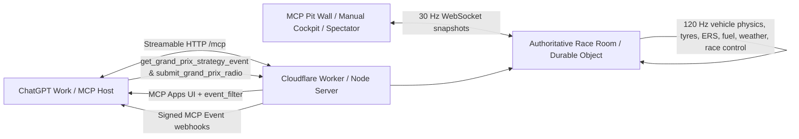

# MCP Grand Prix

Real-time Formula 1 strategy and racing powered by **MCP Apps** and **native MCP Events**. Monza by day. Las Vegas by night. Built for Ruben Casas ([@Infoxicador](https://x.com/Infoxicador)).

- **Live app:** [https://f1.mcp-events.workers.dev](https://f1.mcp-events.workers.dev)
- **MCP endpoint:** `https://f1.mcp-events.workers.dev/mcp`

Team A races Lewis Hamilton’s **#44 Ferrari**. Team B races George Russell’s **#63 Mercedes**. The other 20 drivers from the 2026 F1 grid start alongside them and compete for the same 22-car classification. Open **Full grid** in the timing tower to follow every driver.

---

## How it works

MCP Grand Prix puts **ChatGPT on the pit wall** as your real-time race strategist while the race runs live inside an interactive 3D MCP App widget (and any synced browser spectators).



### Quick start in ChatGPT Work

1. Connect the MCP server at **`https://f1.mcp-events.workers.dev/mcp`** (or rescan the plugin after updates).
2. In a ChatGPT Work chat, prompt:
   > “Use `open_grand_prix_strategy` at Monza. Subscribe this chat to `grand_prix.strategy_required` using the exact `event_filter` returned by the tool. Keep the subscription key out of chat text. For each event, act decisively and send a radio call with `submit_grand_prix_radio`.”
3. The widget opens the **Race setup** modal overlay. Choose your options and click **Accept**—if ChatGPT is already subscribed, updating options in the lobby preserves the active subscription without resetting the room.
4. Once lights go out, setup controls lock and a **Stop race** button appears in both the header bar and the Race menu modal.

---

## Race setup & modes

Open **Race menu** at any time (floating modal overlay; dismiss with `×`, backdrop click, or `Esc` without shifting the race view):

| Option | Choices | Notes |
| --- | --- | --- |
| **Mode** | **ChatGPT strategy** (default) | Native MCP Events webhook drives live pit-wall calls. |
| **Circuit** | **Monza · Day** (5.793 km) / **Las Vegas · Night** (6.201 km) | Real sourced centrelines, distinct sectors, DRS zones, and pit lanes. |
| **Number of laps** | **5 laps** (default) / **10 laps** | 5-lap strategy sprint or 10-lap full pit-window & fuel-sample battle (3–20 laps via MCP tool). |
| **Who’s driving** | **Autopilot** / **Manual** | **Autopilot** drives the racing line obeying ChatGPT calls; **Manual** puts you in the cockpit with keyboard, gamepad, or touch controls while ChatGPT manages strategy. |
| **Add Multiplayer** | **Team B (Mercedes #63)** | Generates a Team B invitation so a second player can join the same live race with their own ChatGPT strategist. |

### Multiplayer (Team A vs Team B)

Enable **Add Multiplayer** in Race setup and click **Accept**. A persistent **Team B invitation** banner appears at the top of the widget:

- Share the invitation with a second player.
- They can either paste it into **Join as Team B with an invitation** inside their widget, or pass `invite` to `open_grand_prix_strategy` in their own ChatGPT Work chat and subscribe to `grand_prix.strategy_required` using their returned `event_filter`.
- Both teams race in the same authoritative room with independent telemetry, pit-wall webhooks, radio banners, and driver controls (Autopilot or Manual). If Team B disconnects or leaves, Mercedes stays under game control.

---

## Game mechanics

### 1. Proactive ChatGPT strategy & composable radio calls

The server publishes `grand_prix.strategy_required` webhooks at race start, on lap boundaries, and whenever tyre wear, fuel margin, traffic, damage, weather, or race control changes meaningfully.

Each webhook carries a rich telemetry **summary** (`compound`, `tyreWear`, `availableSets`, `lapsRemaining`, `gapAheadSeconds`, `gapBehindSeconds`, `chargeKJ`, `marginAboveFuelSampleKg`, `damage`, `pitPhase`, `distanceToPitCommitmentM`, `estimatedRejoinPosition`, `teammateInPitLane`, `flag`, `rain`, `wetness`, `sectorWetness`, `wetGripByCompound`), allowing ChatGPT to act immediately in a single step via `submit_grand_prix_radio`, pull full standings/splits via `get_grand_prix_strategy_event`, or omit `event_id` on either tool to check live telemetry and send proactive mid-race calls at any time.

**Actions:** `hold`, `attack`, `defend`, `harvest`, `save-fuel`, `yield`, `swap`, `swap-back`, `push`, `manage`, `box`, `extend`, `cover`.

**Composable overrides:** combine any primary action with orthogonal parameters for realistic multi-part F1 calls:
- `pace`: `push` | `balanced` | `manage` (e.g., `box` + `pace="push"` for an in-lap push)
- `ers`: `deploy` | `balanced` | `harvest`, plus `budget_kj` (up to `4000 kJ`) and `zone` (`attack`, `defend`, `any`)
- `release_attack_if_behind_gt_s`: conditional ERS release from defense to attack once the gap behind opens
- `box` / `box_lap` (`this-lap` | `next-lap`) / `tyre` (`soft`, `medium`, `hard`, `intermediate`, `wet`)
- `sector` (`1`–`3`) for targeted lift-and-coast fuel saving, `laps` (`1`–`3`) order horizon
- `target_car` (3-letter driver code for clean `yield`) and `revisit_condition`

### 2. Tyres, compounds & FIA sporting rules

- **Five compounds:** `soft`, `medium`, `hard`, `intermediate`, and `wet`, each with distinct peak grip, thermal window, wear curve, and wet-grip crossover characteristics.
- **Finite weekend tyre sets:** Starting allocation is `3 Soft / 2 Medium / 2 Hard / 3 Intermediate / 2 Wet` (minus the fitted starting set). Boxing requires at least one remaining set of the requested compound.
- **Two-compound dry rule:** In dry races (3+ laps), every car must use at least **two distinct dry compounds** or incur a **`+30 s` post-race penalty**.
- **Fuel & FIA sample rule:** Fuel mass affects cornering and acceleration. Races of 10+ laps are tightly fueled around the mandatory **`≥ 1.0 kg` post-race fuel sample** (`+30 s` penalty if short), rewarding targeted sector fuel saving (`save-fuel`).

### 3. Pit stops, double-stacking & crash damage

- **Pit commitment & traffic projection:** Strategy telemetry tracks `distanceToPitCommitmentM`, `estimatedRejoinPosition`, and nearby rejoin traffic so you can time undercuts and overcuts cleanly.
- **Pit lane & service:** `80 km/h` pit speed limiter, `2.6 s` stationary tyre change, and **double-stack risk** when `teammateInPitLane` is true.
- **Collisions & wing damage:** Car-to-car contact and barrier impacts apply panel/wing damage that degrades aero performance and adds up to **`+8.0 s` pit repair time** (`estimatedRepairSeconds`).

### 4. Dynamic weather & live Race Control

Open **Open spectator ↗** in a browser during a live race to access the **Race control** panel:

- **Safety Car:** Deploy immediately or queue for the start of the next leader lap; call **Safety car in next lap** to clear the neutralised queue.
- **Full-Course Yellow:** Neutralises the field with speed limits for 30 race seconds (or until cleared).
- **Rain & track wetness:** Switch between **Dry**, **Light**, **Moderate**, and **Heavy** rain. Wetness evolves dynamically with per-sector drying/wetting rates (`sectorWetness`) and compound grip curves so strategists must judge the slick ↔ intermediate ↔ wet crossover themselves.

Every race control change triggers a fresh strategy event for subscribed strategists.

### 5. Manual cockpit driving

Choose **Manual** under **Who’s driving** in the MCP Race menu—or open `/?drive` in any browser (runs locally at 1× with zero server overhead by default)—to drive the car yourself with keyboard, gamepad, or touch controls while ChatGPT (or the pit wall) calls strategy over the radio:

| Input | Action |
| --- | --- |
| `W` / `↑` | Throttle |
| `S` / `↓` | Brake |
| `A` / `D` | Steer |
| `Space` | DRS (when eligible in DRS zones) |
| `Shift` | ERS Overtake Boost |
| `P` | Request Pit Stop (Box) |
| `C` / `V` | Cycle Camera / Rear View |
| `G` | Switch Driver Mode (Manual / Autopilot) |
| `Esc` | Cockpit Menu |

Configurable assists include **Traction Control** (`off` / `medium` / `full`), **ABS**, and **Pit Assist**.

### 6. Broadcast cameras, ChatGPT Radio & Event Log

- **Cameras:** **44 Onboard**, **63 Onboard** (driver’s-eye view with physical halo, rear-view mirrors, live steering-wheel dash, and articulated gloves), **44 T-cam**, **63 T-cam**, **Broadcast** (stabilised auto-director), **Aerial**, **Side**, **Chase**, **Pits**, **Sphere / The Strip** (Las Vegas), and **Showroom** (Colour / Clay / Wireframe turntable).
- **Instant Replay:** Captures and replays the closest on-track lead change at `0.65×` speed.
- **ChatGPT Radio:** Pinned radio banner inside the race feed with car number, team waveform, progressive transcript, and optional browser speech readout when audio is unmuted.
- **Event Log:** Open by default below the broadcast with filter pills (**All**, **Strategist**, **Radio**), unread counter / jump-to-latest button, preserved scroll position, and expandable formatted JSON payloads with one-click copy.

---

## MCP endpoint reference

Endpoint: `POST /mcp` (Streamable HTTP + native MCP Events JSON-RPC).

- **Events:** `events/list`, `events/subscribe`, `events/unsubscribe` (`grand_prix.strategy_required`, webhook delivery with HMAC verification)
- **Tools:**
  - `open_grand_prix_strategy` — Create or join a ChatGPT strategy race (`circuit`, `laps`, `driver`, `multiplayer`, `invite`)
  - `open_grand_prix` — Open the MCP Grand Prix widget (defaults to ChatGPT strategy; accepts Team B strategy invitations and live spectator invitations)
  - `get_grand_prix_strategy_event` — Read telemetry for a pending `event_id` or pull fresh live mid-race telemetry
  - `submit_grand_prix_radio` — Submit a composable radio order for the active car
  - `configure_grand_prix_strategy` *(app-only)* — Update circuit, lap count, driver mode, or multiplayer in an unstarted lobby while keeping the webhook subscription alive
  - `stop_grand_prix_chat_strategy` *(app-only)* — Stop an active ChatGPT strategy race
  - `grand_prix_status` — Read telemetry for a public room

---

## Run locally

Requires **Node.js 22+**.

```sh
git clone https://github.com/infoxicator/mcp-events-grand-prix.git
cd mcp-events-grand-prix
npm ci
```

### Local MCP App + Host (recommended for testing the widget)

```sh
npm run demo:mcp
# Game & MCP endpoint: http://127.0.0.1:5277/mcp
# Local MCP host UI:   http://127.0.0.1:5278/
# Sandbox iframe:      http://127.0.0.1:5279/
```

### Local Cloudflare Worker (production runtime)

```sh
npm run build
npm run dev:worker
# http://localhost:8787
```

### Standalone browser modes

```sh
npm run dev
```

Open any of these routes on `http://127.0.0.1:5277` (or `https://f1.mcp-events.workers.dev`):

- `/?drive` — Solo manual cockpit race (runs locally in the browser; add `&circuit=las-vegas&laps=10`)
- `/?watch` — Watch a local 1× AI race across the 22-car grid
- `/?solo` — Solo pit-wall race (Ferrari #44 vs full grid)
- `/?strategy` — Strategy scenario replays (undercuts, rain crossovers, fuel saving, double-stacks)
- `/?track` — Circuit flythrough tour
- `/?spectate&camera=showroom` — Car showroom (`&angle=front|rear|side|wheel|steering|airbox|sidepod|halo`)

---

## Verify & deploy

```sh
npm run build            # Typechecks (Node + Worker), Vite web/MCP/host builds, asset & template budgets
npm test                 # Vitest unit & physics suite (257 tests)
npm run test:mcp         # Playwright MCP Apps & host sandbox E2E tests
npm run test:worker      # Playwright Cloudflare workerd + Durable Object + webhook E2E tests
npm run test:e2e         # Full Playwright browser suite
npm run worker:check     # Wrangler dry-run bundle check
```

Production deploys to Cloudflare Workers (`f1` via [`wrangler.jsonc`](wrangler.jsonc)) using Durable Objects (`GameRoom`), static `ASSETS`, and per-IP / per-session rate limiting (`ROOM_CREATION`, `MCP_ROOM_CREATION`).

---

## Circuits, physics & assets

- **Physics (120 Hz fixed step):** Power/traction-limited acceleration, 8-speed gearbox, quadratic aero drag/downforce, slipstream & dirty air, tyre load sensitivity, combined braking/cornering friction envelope, thermal & wear tyre curves, hybrid ERS (`120 kW`, `4 MJ` deploy / `2 MJ` recovery per lap), fuel mass burn, pit lane physics, and collision/barrier impulse & damage.
- **Monza (`5,793.163 m`):** Real centreline from [`bacinger/f1-circuits`, `circuits/it-1922.geojson`](https://github.com/bacinger/f1-circuits/blob/master/circuits/it-1922.geojson) (MIT licence, [`data/LICENSE-f1-circuits.txt`](data/LICENSE-f1-circuits.txt)), with sectors and DRS zones referenced from the FIA circuit map.
- **Las Vegas (`6,227.823 m`):** 17-turn night street circuit with animated Sphere, floodlights, Strip hotels, Bellagio fountains, and underfloor sparks ([`data/LAS-VEGAS-REFERENCES.md`](data/LAS-VEGAS-REFERENCES.md)).
- **3D Models & Textures:** Original Blender 5.2.2 LTS GLB cars (`npm run model:build`) and spatially chunked circuits (`npm run circuit:build`) with baked Cycles AO, GPU-instanced trees/spectators, and CC0 Poly Haven asphalt/sky textures ([`src/race/assets/ATTRIBUTION.md`](src/race/assets/ATTRIBUTION.md), [`data/CIRCUITS-V2-SOURCES.md`](data/CIRCUITS-V2-SOURCES.md)). All sponsor marks are fictional.
