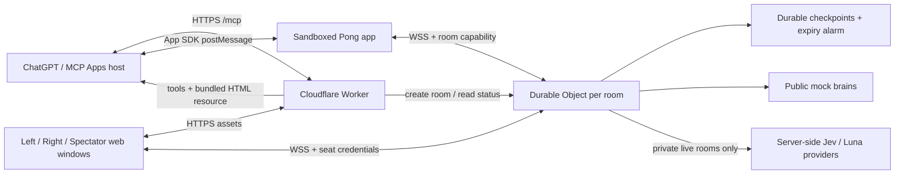
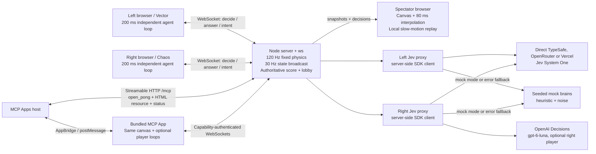

# Jev vs Jev Pong

A recording-ready AI rivalry for Ruben Casas ([@Infoxicador](https://x.com/Infoxicador)). VECTOR plays the angles. CHAOS brings the attitude. Two independent browser agents, one authoritative arena, no human paddle controls.

## Run

Requires **Node.js 22+** and npm. Tested with Node **24.14.0**.

```sh
cd jev-pong
npm ci
npm run demo
```

The launcher starts the Vite + Node server on **http://127.0.0.1:5177**, installs Chromium on first use if necessary, and opens three independent Chromium app windows side by side: **Vector | Spectator | Chaos**. Close a window or press Ctrl+C in the terminal to close the demo and its server. Window positioning uses Chromium's desktop API; a desktop window manager can override it.

For manual windows, run `npm run dev`, then open:

- Player Left: http://127.0.0.1:5177/?side=left
- Player Right: http://127.0.0.1:5177/?side=right
- Spectator: http://127.0.0.1:5177/?spectate

Use one hostname consistently. A player view owns one paddle. Opening an occupied seat becomes a spectator; it never steals the existing player's loop. Both player windows must stay open. Leaving pauses the game in the lobby; reconnecting preserves score and starts a fresh serve. A dropped WebSocket reconnects automatically with backoff. Chromium app windows keep both agent loops active while the spectator is being recorded.

Choose a different port with `PORT=5178 npm run demo`. The launcher refuses an occupied port. Dev HMR uses the game port plus 1000. Production: `npm run build && npm start` serves the built client from the same Node server.

## Cloudflare and ChatGPT

Deployed web app: **https://jev-vs-jev-pong.mcp-ui-flows-nanobanana.workers.dev**

MCP endpoint: **https://jev-vs-jev-pong.mcp-ui-flows-nanobanana.workers.dev/mcp**

In ChatGPT, open **Plugins → + → Add custom MCP server** (or the equivalent custom app/connector entry available to your account), enter the MCP endpoint, choose **no authentication**, and create/install the connection. In a new chat, select Jev Pong and ask **“Open Pong and start both AI players.”** The `open_pong` tool renders the arena; click **Start AI players** if it opens paused. Custom MCP connections must be available/enabled on your account. See [OpenAI’s connection guide](https://developers.openai.com/plugins/deploy/connect-chatgpt).

**Public hosted games always use mock brains**, including Jev vs Luna. Testing ChatGPT does not use your provider keys or AI tokens. Without an invitation, hosted `open_pong({autoplay?, matchup?, player?})` creates a separate 15-minute room; `open_pong({invite, autoplay?})` joins the invited seat in that existing room. `pong_status({room})` reads that MCP room without starting agents. The plain web app creates its own room and provides Vector, Chaos and spectator links in **YOUR PRIVATE MATCH LINKS**. Keep both player windows open, or use the MCP app’s two built-in controllers. A missing player pauses physics. Closing/stopping the MCP app disconnects its controllers; an idle room has no active physics interval and can hibernate. A room expires after 15 minutes.

### One player in ChatGPT, the other in Claude

Connect **both hosts to the same `/mcp` endpoint** above. In Claude, use **Customize → Connectors → + Add → Add custom connector** with that remote URL; see [Claude’s remote connector guide](https://support.claude.com/en/articles/11175166-get-started-with-custom-connectors-using-remote-mcp). Refresh/reconnect existing MCP connections after this update so both hosts see the new tool inputs.

1. In ChatGPT, ask: **“Open Pong with player=left and autoplay=true. Only start my left AI player.”**
2. In the rendered app, use **Copy invitation**. The code has the form `pong:<room-id>:right:<seat-credential>`. Share it only with the other player; it grants access to that seat, never match-owner permissions.
3. In Claude, ask: **“Join this existing Pong game and start the right AI player. Use this invitation: <paste code>.”** This calls `open_pong({invite:"pong:...",autoplay:true})`; it must join, not create a new room.
4. Click **Open web app** in the first app (the public spectator link) and watch in your browser. Keep both MCP app views open and visible. The game waits until both seats are connected; closing either host pauses it. Invitations expire with the room after 15 minutes.

Both views connect to `/api/rooms/<same-room-id>/ws`. That ID routes every socket to the same authoritative Durable Object. Invitations carry a seat credential in addition to the room ID, so a spectator who knows the room cannot take a paddle. A joining app receives only its own seat link and cannot reset the match, change the matchup, or acquire the other seat. The original `player=both` default still runs the two players from one MCP view; `player=spectator` opens without controllers. For the local Node server, both MCP hosts can use the same local endpoint and choose `player=left` / `player=right`; room invitations apply to the hosted multi-room server.

ChatGPT and Claude host the independent player loops; their conversation models do not choose individual paddle moves. Public hosted decisions remain mock Jev/Luna brains, with no provider-token spending. The split-host workflow is verified with independent real SDK AppBridge contexts and a normal browser spectator; account-level ChatGPT/Claude installation is manual.

The Worker serves Vite assets and stateless Streamable HTTP MCP. One SQLite-backed Durable Object per room owns fixed-step physics, score, WebSockets, replay and capability authorization. Native browser WebSockets consume 30 Hz snapshots with 80 ms interpolation. MCP views use a per-room capability for sandbox-origin connections and separate owner/seat credentials; these are delivered in tool-result `_meta`, not model-visible content. Public spectator links contain no seat credentials. Room creation is rate-limited. No provider keys enter the browser or the MCP resource.



To deploy a change using a Cloudflare account with Workers/Durable Objects permissions:

```sh
npx wrangler login
npm run deploy
```

The checked-in `wrangler.jsonc` targets the existing `jev-vs-jev-pong` Worker and account; adjust its account/name for your own deployment. Secrets are **not** loaded from `.env.local` on Cloudflare. To enable owner-created private live rooms, configure Worker secrets with `npx wrangler secret put ROOM_CREATE_TOKEN`, `TYPESAFE_API_KEY` (direct Jev), and optionally `OPENAI_API_KEY` (Luna); `JEV_PROVIDER=typesafe` can be a Worker variable. Never share the room-creation token. Create a live room by POSTing `/api/rooms` with a same-origin `Origin` header and `Authorization: Bearer <ROOM_CREATE_TOKEN>`; returned fragment links are private owner/seat capabilities. Without that authorization, room creation always forces mocks even if provider secrets exist. MCP tools always create mocks. Private live rooms have a durable 1,200 paid-attempt budget and respect provider cooldowns. This is capability access, not email/Cloudflare Access identity authentication.

To reproduce hosted verification:

```sh
npm run test:clock
npm run test:worker # temporary local workerd + sandbox host; stops when tests finish
LIVE_URL=https://jev-vs-jev-pong.mcp-ui-flows-nanobanana.workers.dev npm run test:worker -- e2e-worker/mcp.spec.ts
```

The hosted MCP test uses a real SDK client and SDK AppBridge host: HTTPS discovery/calls/resource read, sandboxed UI, authenticated WSS, scoring, spectator synchronization, replay, fullscreen, mode switching and teardown. This validates the deployed server and app protocol; installation inside your ChatGPT account remains a manual step. It does not start a persistent local demo.

## Local MCP App

The existing web URLs and three-window demo continue to work. Each local game server also exposes **Streamable HTTP at `/mcp`**. Local MCP and web views on the same game port share one authoritative arena; Cloudflare uses separate rooms as described above.

```sh
npm run demo:mcp
```

Open **http://127.0.0.1:5178/** and click **Start AI players**. The local host connects to MCP **http://127.0.0.1:5177/mcp**, reads the tool's linked HTML resource, and renders the app through the official SDK's `AppBridge` in a separate-origin sandbox on port 5179. The web spectator remains **http://127.0.0.1:5177/?spectate**. Add `?autoplay=1` to the host URL to explicitly start agents on opening.

If port 5177 is already running another game, use `PORT=5197 npm run demo:mcp`; then the MCP endpoint is **http://127.0.0.1:5197/mcp**, host **http://127.0.0.1:5198/** and sandbox port 5199. Different game ports create separate matches. `MCP_HOST_PORT` overrides the host port, with its sandbox on the following port.

To attach the local host to an already-running updated game, first run `npm run build` and `npm start`, then `npm run mcp:host` in another terminal. In another MCP client, add the game's `/mcp` URL as a **Streamable HTTP** server and call **`open_pong`**. Local loopback URLs require a host that can reach this machine. An MCP Apps host renders the game; a text-only client receives its score and spectator link. Verified with the real MCP SDK client and included Apps SDK host. For remote clients such as ChatGPT, use the deployed HTTPS endpoint above.

- **`open_pong({ autoplay?: boolean })`** opens the arena, read-only by default. `autoplay: true` connects one controller per empty seat when the UI mounts. Existing web players retain their seats.
- **`pong_status({})`** reads authoritative score, connectivity, accepted intents and latest decision metadata, without making provider calls.
- **`ui://jev-pong/arena.html`** is the linked resource with MIME type `text/html;profile=mcp-app`. `vite-plugin-singlefile` bundles the shared canvas renderer, styles and local fonts into one HTML file.

`demo:mcp` defaults to **mock mode**, even when `.env.local` contains keys. Use `JEV_MOCK=0 npm run demo:mcp` to explicitly enable configured paid providers, and `PONG_MATCHUP=jev-vs-luna` for Luna at startup or select it in the UI. Opening a read-only view starts no AI calls. **Start AI players** can incur charges in live mode; existing pacing and fallback labels apply.

The MCP entry uses the official `App` lifecycle, host styles, safe-area insets, fullscreen and `openLink`. Scrolling it offscreen pauses rendering and disconnects its own controllers; stopping or closing it preserves separate web players. The view uses native WebSockets with a random two-hour connection capability supplied in tool-result `_meta`; it is not a provider key and is omitted from model-visible structured output. Ordinary web Origin checks remain enforced. MCP HTTP rejects nonlocal browser origins and invalid Host headers. The resource's CSP allows only the game's WebSocket origin; the included test host uses a separate-origin double-iframe sandbox. These controls target a loopback demo, not public multi-user hosting.

`npm run test:mcp` starts an isolated mock game/host/sandbox on ports 5297–5299, connects a real MCP SDK client, and runs Playwright against the embedded app and separate web contexts. It verifies the MCP handshake, linked HTML, gameplay, both AI intents, scoring, shared state, replay, fullscreen, Luna selection, stop/start, seat ownership and teardown. Screenshot: `artifacts/mcp-app-scored.png` (ignored by Git).

## Jev versus Luna mode

The original **Jev vs Jev** matchup remains the default. Choose **Jev vs Luna** in the arena to run Jev on the left and **GPT-6 Luna through OpenAI Decisions** on the right. Mode changes start a fresh match and are broadcast to every connected window; refreshing a player keeps the server-selected matchup.

To open the three windows with Luna already selected:

```sh
npm run demo:luna
```

Or set `PONG_MATCHUP=jev-vs-luna` when starting `npm run dev` or `npm start`. Add this server-side credential to the ignored `.env.local` file to enable real Luna decisions:

```dotenv
OPENAI_API_KEY=your-openai-api-key
# Optional: fail startup/mode activation if the OpenAI key is missing.
LUNA_MOCK=0
```

Configure a real Jev provider as described below to run both sides live. Each side independently defaults to a mock if its own key is absent; the header shows **LIVE + MOCK** for a mixed configuration. `LUNA_MOCK=1` mocks only Luna. `JEV_MOCK=1` forces both players to use mocks, even if keys are configured. Each decision card identifies the actual model and whether its action was live, mocked, or a fallback. A mock Luna match exercises the wiring and presentation; it does not evaluate Luna's ability.

### Luna rate limits and proof of live decisions

Fast inference does not remove account quotas. The original 200ms Luna loop could issue 300 calls/minute. At the observed roughly 735 tokens/request, that demands about 220,500 tokens/minute. The live account returned a 60,000 TPM error and subsequently an exhausted 50 requests/day error. At five calls/second, 50 requests cover just ten seconds. Jev uses a separate provider and quota; successful Jev calls do not establish available OpenAI capacity.

Luna now sends rounded game coordinates and shorter question descriptions while retaining all three typed choices and 17 paddle lanes. Live Luna calls pause at least 600ms after each response. The proxy increases this pause using actual input-token usage, the tighter configured/provider TPM limit, and 20% headroom. Override the app's budget in `.env.local`:

```dotenv
LUNA_INTERVAL_MS=600
LUNA_TPM_BUDGET=60000
```

These settings only pace the app; they cannot increase the account's limits. On errors, the proxy supplies a labeled heuristic fallback and a cooldown. HTTP 429 responses honor `Retry-After`; failures without that header use bounded exponential backoff. Client and server enforce the cooldown, which survives reconnect, new match, and matchup changes within the server process. A later call uses current game state rather than retrying a stale snapshot.

The header displays **API FALLBACK** when either latest action is a fallback. **APIS CONFIGURED** means credentials are configured but no live decision has been observed yet. The per-player labels **JEV / SYSTEM ONE** and **LUNA / DECISIONS** identify successfully decoded provider responses. Hover a Luna response time to inspect HTTP status, input tokens, request ID, and call delay; the same safe metadata travels in WebSocket `state.decisions.right.api`. Rate-limit warnings show the recognized token/request limit without forwarding raw error messages or credentials.

For sustained live Luna play, check [OpenAI account limits](https://platform.openai.com/account/rate-limits) and [billing](https://platform.openai.com/account/billing), enable a suitable paid allowance or request a limit increase. Waiting for a daily limit to replenish offers only another small burst if the 50/day ceiling remains. A new key in the same organization does not create a separate organization allowance. See the official [rate-limit guide](https://developers.openai.com/api/docs/guides/rate-limits) and [Decisions guide](https://developers.openai.com/api/docs/guides/decisions).

`npm run test:quota` runs three browser contexts against a local Decisions HTTP fixture: a live success followed by a daily-limit 429. It verifies pacing, visible fallback status, continued play by the other agent, and no extra upstream calls after reconnect/reset. This is a local simulation, not evidence of available real-account quota.

`server/luna.ts` uses Web-standard `fetch` to call **`POST https://api.openai.com/v1/decisions`** with the model pinned to **`gpt-6-luna`**. This uses the Decisions endpoint, not Responses or chat completions. It sends a user message with text rules and an `input_json` game snapshot. Three typed `choice` questions ask for the same 17 target lanes, movement directions, and persona taunts used by Jev. Both sides receive the same geometric intercept hint and have the same 200 ms scheduling and paddle-speed limits. The action controller still follows `target_y`; `move` is informational.

OpenAI returns a named `answers` array. The adapter validates each expected choice, refuses unknown lanes/models, and treats refusals, missing/duplicate answers, invalid confidence, HTTP errors, or a 1500 ms timeout as a **Luna-labeled heuristic fallback**. There are no automatic retries. Keys and provider HTTP requests stay on the server. The browser receives safe player metadata and actions only.

Source checked for this implementation: [official OpenAI Decisions guide](https://developers.openai.com/api/docs/guides/decisions) and [create-decision API reference](https://developers.openai.com/api/reference/resources/decisions/methods/create). `npm run test:luna` exercises the real HTTP adapter against local contract fixtures; no paid OpenAI call is needed. `npm run verify` now includes this test and a second three-context Playwright scenario that scores a Jev-vs-Luna point in mock mode, checks model labels across views, switches back to Jev-vs-Jev, and tests reset/reconnect/layout.

## Recording for X

Record the spectator window at 1440×1080 or 1920×1080; maximize that window after the three seats connect. The layout also fits a 1280×800 laptop and narrow player windows. Click **Title card**, start recording, then **Start fresh match**. The title card resets the score as it closes. Alternatively use `/?spectate&intro`.

The arena includes luminous ball trails, target markers, a live rally counter, best rally, match point at six, a winner at seven, and automatic rematches. Each agent shows its latest structured decision, confidence, measured round-trip decision time, and a persona-specific taunt. Everything important is visible with the audio muted. **Replay last point** plays the previous point's final eight seconds at 0.65× speed, locally; **Back to live** returns immediately. Live agents keep playing during replay. **New match** resets score and history.

Fonts ship locally. There are no external image or font requests and no account or internet needed after installation in mock mode.

## Add a real Jev key

```sh
cp -n .env.local.example .env.local
```

Edit `.env.local` with **one** provider:

Use your own **TypeSafe Jev key** directly:

```dotenv
JEV_PROVIDER=typesafe
TYPESAFE_API_KEY=your-typesafe-key
JEV_MODEL=jev-latest
JEV_MOCK=0
```

This uses the official SDK's direct `https://api.typesafe.ai/v1/systemone` endpoint. No gateway account is needed. The [official TypeSafe SDK](https://github.com/typesafe-ai/typesafe-sdk-js) documents `TYPESAFE_API_KEY` and the `jev-latest` default.

Or use OpenRouter:

```dotenv
JEV_PROVIDER=openrouter
OPENROUTER_API_KEY=your-openrouter-key
JEV_MODEL=jev-1.13
JEV_MOCK=0
```

Or:

```dotenv
JEV_PROVIDER=vercel
AI_GATEWAY_API_KEY=your-gateway-key
JEV_MODEL=typesafe-ai/jev
JEV_MOCK=0
```

Restart the server after editing. `JEV_MOCK=1` always forces mock mode. Without any key, mock mode is automatic. `JEV_MOCK=0` fails startup if a real key for the selected provider is missing. If multiple keys exist, direct TypeSafe takes precedence, then OpenRouter, then AI Gateway; `JEV_PROVIDER` overrides this choice. Provider model IDs can be changed with `JEV_MODEL`.

Locally, keys load only in Node from the ignored `.env.local` file; on Cloudflare, use Worker secrets; never use a `VITE_` prefix. The browser never imports the SDK, receives credentials, or calls a provider. Each joined player triggers its own server-side `TypeSafeClient` proxy. Requests use the server's current state, not a client-supplied snapshot. Requests stop in the lobby and at match end; there is at most one in flight per player. Real mode makes paid provider calls, up to five calls per second per player when responses are fast enough.

## The real SDK API

This uses **`@typesafe-ai/sdk` 0.7.0**, checked against its installed npm README and TypeScript declarations. Jev is a System One decision model: it selects from typed alternatives, rather than writing arbitrary JSON or free-form trash talk.

`server/jev.ts` calls `TypeSafeClient.systemOne({ model, state, questions })` with three `choice()` questions. The response's `answers.<name>.choice` selects:

- `target`: one of 17 paddle-center lanes, converted to a numeric `target_y`.
- `move`: `up`, `down`, or `stay`, shown as the model's movement classification.
- `taunt`: one of four short lines belonging to that persona.

The smooth controller follows `target_y`; the `move` field is informational. The compact snapshot contains ball position/velocity, both paddles, side, score, rally, and tick. A local geometric intercept is included as evidence in real-mode state; **Jev chooses the lane**, and may disagree with it. This is an assisted decision demo, not a claim of learned Pong skill or a model benchmark.

Provider routing follows the documented System One-compatible APIs:

| Provider | SDK `baseURL` | Default model |
| --- | --- | --- |
| OpenRouter | `https://openrouter.ai/api` | `jev-1.13` |
| Vercel AI Gateway | `https://ai-gateway.vercel.sh/typesafe` | `typesafe-ai/jev` |

The SDK appends `/v1/systemone`. Compression is disabled for gateway compatibility. Calls have a 1500 ms timeout and no retries; a provider error, invalid answer, or timeout uses the heuristic for that decision and visibly labels **FALLBACK / HEURISTIC**. The header identifies the configured provider; each decision card identifies the actual decision source. Taunts are throttled for reading, so a bubble can lag the latest action.

Sources: [official SDK repository/README](https://github.com/typesafe-ai/typesafe-sdk-js), [OpenRouter's TypeSafe SDK guide](https://openrouter.ai/docs/guides/community/typesafe-sdk), [Vercel's Jev integration guide](https://vercel.com/i/jev-integrations). Live provider billing, model availability, and performance require a valid key and are not established by the offline tests.

## Architecture



Physics has no clock, randomness, I/O, or AI calls: `step(state)` always advances exactly 1/120 second. A monotonic accumulator runs it on the server, caps catch-up after long stalls, and pauses the match when a seat is empty. Intents are validated against the latest server-issued decision sequence, consumed once, clamped to the court, and followed with proportional smoothing and a maximum paddle speed. Stale intents recover toward center. Clients only render buffered authoritative snapshots; they never integrate ball physics or decide scores.

The server stores up to eight seconds of 30 Hz frames for highlights. This local demo has one in-memory match, binds to loopback, checks WebSocket Origin, and limits message size/rate. Reloading the server clears match history. The hosted variant uses the Durable Object storage and deployment described above.

## What's mocked

With no key (or `JEV_MOCK=1`), **both AI calls** are replaced by an explicitly labeled seeded heuristic brain. It projects wall bounces, recovers to center, and adds persona-specific noise that grows during rallies. Simulated decision latency is 45–91 ms. Confidence is synthetic. Taunts are selected from the same finite catalog used for real Jev questions.

**Nothing else is mocked:** browser contexts, HTTP, WebSockets, physics, paddle smoothing, scoring, join/leave/reconnect, and replay are real. Real-provider adapter verification runs the actual SDK against a local HTTP fixture that follows its documented response contract. It does not prove a live provider accepts an account's key or serves a particular model.

## Verification

```sh
npx playwright install chromium
npm run build          # strict TypeScript check + Vite production build
npm test               # Vitest in real headless Chromium
npm run test:provider  # actual Jev SDK over local HTTP: success, 429, malformed, timeout
npm run test:luna      # OpenAI Decisions HTTP contract, refusal/errors/timeout, per-side config
npm run test:quota     # HTTP + browser loops: pacing and daily-limit cooldown
npm run test:e2e       # production server + three separate browser contexts
npm run test:mcp       # real MCP client + sandboxed UI + scored shared match
PORT=5178 JEV_MOCK=1 npm run demo:smoke
```

`npm run verify` runs build, unit tests, both provider adapter tests, quota checks, web e2e and MCP verification in sequence. The e2e starts and stops its own server on 5187 with `JEV_MOCK=1`, opens left/right/spectator in separate contexts, observes actual WebSocket frames and sent agent intents, checks ball/paddle movement, waits for a point, exercises replay, disconnects and reconnects a player, preserves score, reloads a seat, opens the title card, resets the match, and checks a 480px layout for horizontal overflow. Screenshots are saved under ignored `test-results/`. `demo:smoke` launches the real launcher in headless mode and checks both player connections and visible mock decisions.

Unit coverage: deterministic stepping, lobby/serve, wall and paddle collisions, rally acceleration, scoring once, win condition, target bounds, reflected intercept prediction, reproducible noise, valid actions, persona taunts. See `VERIFICATION.md` for recorded commands and outcomes.

Local milestone commits: M1 physics and canvas; M2 Jev and mock brains; M3 authoritative network play; M4 recording polish, launcher, docs and final verification. Only local Git commits are used; source is never pushed. The built app is deployed to the authorized Cloudflare Worker.
