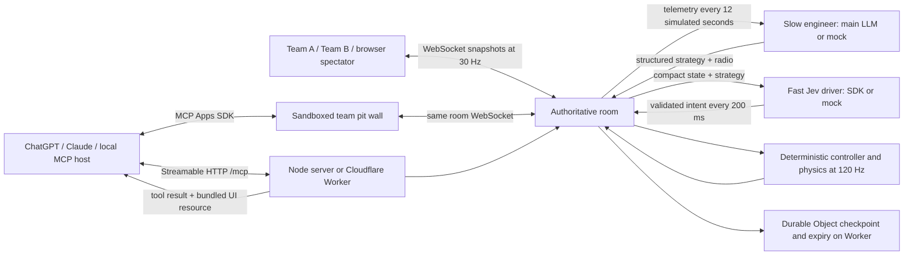

# MCP Grand Prix

Two teams. Two speeds of intelligence. Monza by day. Las Vegas by night. Built for Ruben Casas ([@Infoxicador](https://x.com/Infoxicador)).

Player A races Lewis Hamilton’s **#44 Ferrari**. Player B races George Russell’s **#63 Mercedes**. The other 20 drivers start alongside them and race for the same classification. Both circuits use the November 2026 Las Vegas entry list and a game-specific starting order. Open **Full grid** in the timing tower to see every driver. [Official F1 driver roster](https://www.formula1.com/en/drivers)

Each player has a race engineer and a driver. Choose **Jev vs Jev** or **Jev vs Luna**. In the latter, Jev drives for Ferrari and GPT-6 Luna drives for Mercedes. The engineer chooses strategy, the driver chooses intent, and the local controller handles acceleration, braking and steering. Every window watches the same authoritative race.

## Run

Requires **Node.js 22+** (verified on 24.14.0).

```sh
cd jev-grand-prix
npm ci
npm run demo
```

The launcher starts a local server on **http://127.0.0.1:5277** and opens three independent Chromium app windows side by side: **Ferrari | Broadcast | Mercedes**. Click **Start race** once the grid is ready. It installs Chromium if missing. Ctrl+C or closing a demo window cleans up its browsers and server. An occupied port is rejected; use `PORT=5278 npm run demo` for another instance. The demo defaults to `JEV_MOCK=1`, even when a local key exists.

Manual windows:

```sh
npm run dev
# http://127.0.0.1:5277/?team=a
# http://127.0.0.1:5277/?team=b
# http://127.0.0.1:5277/?spectate
```

Production assets locally: `npm run build && npm start`. Reachability: `curl --fail http://127.0.0.1:5277/health`. Circuit tour: `/?track`.

Keep both team seats open. Missing seats pause physics without losing laps, tyres or strategy. WebSockets reconnect with backoff; an occupied seat becomes a spectator. Separate rooms have distinct owner, team and sandbox capabilities. Team credentials live in URL fragments and the WebSocket join message. Spectator URLs contain none.

## Record for X

Maximize the broadcast window to 1440×980 or 1920×1080. Open **Title sequence** for the intro, then select **Continue to race** and **Start race**. The opening title is also available with `/?spectate&intro`. The engineer/radio panels, battle banner, timing tower and telemetry work with the sound muted.

Use **44 Onboard**, **63 Onboard**, **Broadcast**, **Aerial** or **Car detail** to switch cameras. Onboard includes the physical halo, visible nose/wheels and a steering wheel dash with gear, speed, DRS and ERS. Broadcast rotates every 7–9 real seconds through stabilised Side, both teams’ T-cams and driver-eye onboards, Aerial and Chase. Each shot holds steadily; race events do not trigger extra cuts. Choose Side, Chase, Aerial or an onboard button to hold that view manually; Broadcast restarts the rotation. **Instant replay** replays the closest captured on-track lead change at 0.65×; **Back to live** restores the race. Results list all 22 drivers in finishing order with their race times. **Race again** resets the owner’s race.

Three laps take about 80–100 wall seconds at the default **4× race clock**. `npm run demo:realistic` uses real simulation time (1×); up to 24× is supported for tests. Tyre degradation is deliberately accelerated so undercuts matter in three laps. Engineers update every 12 simulated seconds (3 wall seconds at 4×). Drivers request a decision every 200 ms, with one request in flight per team. A late response never advances or rewinds physics.

## Real agents and keys

No keys were copied from Pong. All verification uses mocks or injected fixtures. To configure real agents:

```sh
cp .env.local.example .env.local
```

For a direct Jev key:

```dotenv
JEV_PROVIDER=typesafe
TYPESAFE_API_KEY=your-key
JEV_MODEL=jev-latest
JEV_MOCK=0
```

Or choose `JEV_PROVIDER=openrouter` with `OPENROUTER_API_KEY` and `JEV_MODEL=jev-1.13`; or `JEV_PROVIDER=vercel` with `AI_GATEWAY_API_KEY` and `JEV_MODEL=typesafe-ai/jev`. This reuses Pong’s official `@typesafe-ai/sdk` 0.7.0 `TypeSafeClient.systemOne({state,questions})` integration, with `choice()` questions for line, pace, brake aggression, ERS, DRS and a persona-driven radio reply. [Official SDK source](https://github.com/typesafe-ai/typesafe-sdk-js).

The slow engineer uses server-side OpenRouter or Vercel AI Gateway chat completions:

```dotenv
ENGINEER_PROVIDER=openrouter
OPENROUTER_API_KEY=your-key
ENGINEER_MODEL=openai/gpt-4.1
ENGINEER_MOCK=0
```

For Gateway, set `ENGINEER_PROVIDER=vercel` and `AI_GATEWAY_API_KEY`. The model is configurable. Engineer output is validated JSON: pace, ERS mode, pit instruction, next compound, attack/defend/hold and a short radio line. Failures use explicitly labelled rule-based fallbacks. Requests have timeouts and no automatic retries.

Run `JEV_MOCK=0 npm run demo` to opt into configured live providers. `npm run dev` and `npm start` read `.env.local`; no configured key means automatic mock for that brain. **`JEV_MOCK=1` overrides every provider**, including the engineer. `ENGINEER_MOCK=1` mocks only engineers. Keys, provider URLs and SDK clients stay on the server; no provider secrets are bundled into web or MCP HTML. Live API availability and spending were not tested. The UI labels mock, live and fallback decisions individually. The header shows **APIS CONFIGURED** until a real response is observed, **JEV LIVE** after successful Jev decisions, or **API FALLBACK** when a driver fails. The driver card shows **confirmed responses / attempts** and a safe error message with HTTP status. `/health` exposes the same per-team attempt/success/fallback counters and latest error metadata. A configured key alone does not establish successful inference.

Authentication failures (401/403) disable further Jev requests until the server restarts. Correct the ignored `.env.local` key, stop the old process and run `JEV_MOCK=0 npm run demo`. Rate limits honor `Retry-After`; transient network/provider failures use bounded backoff. Cooldowns survive seat reconnects and race resets. Raw provider response bodies and keys never enter public error messages.

## Jev versus Luna

```sh
npm run demo:luna
```

This opens **Ferrari / Jev** against **Mercedes / GPT-6 Luna**. It defaults to mock mode. The race owner can also choose **Jev vs Luna** from the **Drivers** selector above the feed; changing the matchup starts a fresh race and updates every connected view. Team seats and invitation credentials stay intact. `RACE_MATCHUP=jev-vs-luna` selects the initial mode for `npm run dev` or `npm start`.

For real Jev and real Luna, put both keys in the ignored `.env.local`:

```dotenv
JEV_PROVIDER=typesafe
TYPESAFE_API_KEY=your-typesafe-key
JEV_MODEL=jev-latest
OPENAI_API_KEY=your-openai-key
ENGINEER_MOCK=1
```

Then launch explicitly:

```sh
JEV_MOCK=0 LUNA_MOCK=0 npm run demo:luna
```

Stop an existing demo first so port 5277 is free. Engineers remain mocked in this example; configure them separately above if desired. Real Jev success displays **JEV / SYSTEM ONE**; real Luna success displays **LUNA / DECISIONS**. Both driver panels expose confirmed-response counters. **LIVE + MOCK** indicates one driver lacks a key or is explicitly mocked; **API FALLBACK** means an attempted provider call failed.

Luna ports Pong’s server-side **`POST https://api.openai.com/v1/decisions`**, pinned to **`gpt-6-luna`**. It receives compact JSON telemetry and the engineer instruction, then answers the same six bounded choices as Jev: racing line, pace bias, brake aggression, ERS, DRS and a persona radio reply. Named answers are decoded independently of order; refusals, missing/duplicate answers, invalid choices/confidence, wrong models, HTTP failures and timeouts are labelled Luna fallbacks. No automatic HTTP retries occur. See the [official OpenAI Decisions guide](https://developers.openai.com/api/docs/guides/decisions).

As in Pong, live Luna defaults to **600 ms after each response**, paced further by actual input tokens, the tighter configured/provider token budget and request limits, with 20% headroom. Configure `LUNA_INTERVAL_MS` (200–60000, default 600) and `LUNA_TPM_BUDGET` (default 60000). The local controller continues at 120 Hz while inference is in flight. HTTP 429 honors `Retry-After`, including long daily limits. The panel reports recognized numeric quota units without exposing upstream messages, organization IDs or keys. Authentication failures require a corrected key and server restart. Provider cooldowns survive race reset, seat reconnect and switching away from and back to Luna.

`JEV_MOCK=1` forces **all** providers to mocks; `LUNA_MOCK=1` mocks only Luna. No key automatically mocks that driver; `LUNA_MOCK=0` explicitly requires `OPENAI_API_KEY`. All tests, including the full Jev-vs-Luna race and MCP invitations, use mock brains or injected response fixtures. No real Luna quota or inference success is claimed by these checks.

## MCP Apps: two hosts, one race

The local server exposes **Streamable HTTP at `/mcp`**. The linked `ui://jev-grand-prix/pit-wall-v28.html` resource serves a small HTML template using the official MCP Apps SDK. The sandbox loads versioned game assets from the same server over HTTPS in production. The included host uses `AppBridge` through a separate-origin double-iframe sandbox.

```sh
npm run demo:mcp
# Game + MCP: http://127.0.0.1:5277
# MCP host:   http://127.0.0.1:5278/?player=a&autoplay=1
# Sandbox:    http://127.0.0.1:5279
```

Use another PORT if a demo is already running. Or run `npm run build && npm start`, then `npm run mcp:host` separately. The local host can connect only to a server reachable from its machine; registration in real ChatGPT/Claude accounts was not automated.

Connect ChatGPT and Claude to the same MCP endpoint. The widget opens **Race menu** before the start. Use **Race setup** to choose a mode, circuit, available driver matchup, and seat. The current race, invitations, and spectator actions have separate sections. When the race starts, the menu closes and moves below the broadcast. Use **Race menu** to open it again.

1. In the first host, open MCP Grand Prix as team A. Select **Ready team A** and copy the **team B invitation**.
2. In the second host, use **Join an existing race** or ask the host to join with the full invitation. Select **Ready team B**. When both seats are ready, click **Start race**.
3. Select **Open spectator** for a third, ordinary browser. The two pit walls and the spectator use the same race clock, telemetry, and radio.

**Leave team** or closing its app releases that seat and pauses a running mock race. An automatic reconnect reclaims the same seat when it becomes available. A new view can rejoin with the original invitation. Clipboard restrictions fall back to a selected read-only field. The browser also supports **Invite a team → Join by invitation**. Opening both teams in one app fills both seats if you select **Ready both teams**. Copying the opponent invitation releases team B. The **Strategy replays** control opens the existing benchmarks in the browser.

Local MCP rooms expire after two hours. Public Worker rooms expire after 15 minutes and always force mocks. Pass `matchup:"jev-vs-luna"` when creating a race to select Luna. An invitation preserves the existing room’s matchup regardless of the second host’s defaults. The included host accepts `?player=a&autoplay=1&matchup=jev-vs-luna`. MCP protocol, sandbox, invitations and shared-race behavior are tested with the actual SDK, not a simulated postMessage host.



## Solo races

In the MCP app, select **Solo** and open its lobby. In the browser, select **Open solo lobby**. Click **Start race** when the grid is ready. You take Ferrari's seat and the game drives Mercedes as part of the 22-car grid. Solo races keep the usual circuits, strategy, radio, pit stops, and race classification. Leaving Ferrari's seat pauses the race until you reconnect.

The `open_grand_prix` tool also accepts `solo: true`. `autoplay: true` connects the seat automatically. The countdown waits for **Start race**.

## Private live races

Choose **Private live** in the widget, select a circuit and strategist, and click **Start live race**. Match the pairing code on the owner page, authenticate with Cloudflare Access email PIN, review the preselected options, then click **Confirm and start live race**. The app polls using its in-memory pairing proof and switches to the confirmed race. Both drivers run on the Worker. Choose the race server strategist or the paired ChatGPT strategist.

**Copy live invitation** lets the second MCP app join as a spectator. **Open live spectator** opens the same room in a browser. **Stop live race** opens the Access-protected owner page for that race. The owner page and both MCP views keep the spectator invitation available after the race stops. The spectator capability grants access to the feed and browser race controls. It travels in the browser URL fragment and WebSocket join message. It is not part of an HTTP request URL. Provider keys and the Access identity token stay outside MCP results.

Private live races are limited to three laps, five minutes, and 240 outbound provider requests. Finishing, stopping, or reaching a limit cancels further calls. A Worker interruption ends live execution. Reopening a completed or interrupted race retrieves its last snapshot. Repeating a start confirmation returns its original room. Public demos and strategy replays use built-in drivers on the Worker.

### ChatGPT as the live race strategist

Rescan the MCP Grand Prix plugin after updating the server. In a ChatGPT Work chat, ask, “Use `open_grand_prix_strategy` at Monza. Subscribe this chat to `grand_prix.strategy_required` using the exact event filter returned by the tool. For each active event, read its telemetry and send one radio call.” Work chats can use the web app or the desktop app with Cloud selected. When the widget shows that the subscription is verified, click **Start race**. [ChatGPT MCP Events](https://developers.openai.com/plugins/build/mcp-events)

Ferrari starts with its own strategy. The public race starts solo at 1× speed for 20 laps and uses built-in drivers. The host can stop it with **Stop strategy race**. The Worker allows up to one hour. Choose **ChatGPT strategy** in Race setup and open its lobby or call `open_grand_prix` with `chat_strategy: true`, then subscribe and click **Start race**.

To add a second player, use **Copy Mercedes invitation** and have them paste the code into **Join an existing race** in their own widget. They join the running race with their own telemetry and radio for Mercedes. For native MCP Events, pass the same invitation to `open_grand_prix_strategy` in the second Work chat and subscribe using its returned filter. Mercedes stays under game control whenever the second strategy connection is absent.

Open **Spectator** in a browser during a live race to access **Race control**. Deploy a safety car now or queue another for the start of the next leader lap. **Safety car in next lap** cancels a queued deployment and sends the active safety car back to the pits. Race restrictions lift at the next lap line unless yellow flags are active. Yellow flags slow the whole field for 30 race seconds, or until cleared. Rain has light, moderate and heavy settings. Select Dry to stop the rain while the track dries. Each change prompts a fresh strategy event with the flag, scheduled safety car lap, wetness and tyre recommendation. ChatGPT can call for slicks, intermediates or full wets over the radio.

To pair ChatGPT with paid Jev drivers, use **Start live race**, sign in through Cloudflare Access, and select **ChatGPT Work via native MCP Events** on the confirmation page. In the paired Work chat, ask ChatGPT to subscribe to this race’s strategy events. Once the subscription verifies, click **Start race** in the widget to begin paid driving.

The server publishes `grand_prix.strategy_required` at the opening of the race, on new laps, and after significant tyre, fuel or traffic changes. Native MCP Events uses `events/list`, `events/subscribe`, and `events/unsubscribe` on the Worker. The server verifies ChatGPT's callback and sends signed telemetry summaries to it. ChatGPT reads the snapshot with `get_grand_prix_strategy_event` and sends a decision with `submit_grand_prix_radio`. The pit wall updates over its WebSocket.

The event includes position, speed, tyre wear and temperature, sector gap estimates, fuel projection, battery charge and pit commitment. The tool accepts hold, attack, defend, sector fuel save, yield, push, manage, box, extend and cover. The assigned car gets its accepted strategy through radio. **ChatGPT radio** appears inside the race feed above the circuit map. The driver’s number, team waveform, and progressive transcript identify each accepted call. Enable sound to hear it read by a local browser voice when available. The server enforces one call per event and the race's pit commitment and resource rules. Live races support slicks, intermediates and full wets. The weather and teammate exercises are available in **Strategy replays**.

Expand **Event log** below the broadcast and filter by **Strategist**, **Driver** or **Radio**. Open a row to inspect its payload. The strategist log shows the telemetry snapshot, signed event delivery and when ChatGPT reads it. The driver log records the decisions applied to the car. Radio includes pit-wall calls and acknowledgements from live drivers. A browser reload retrieves the recent entries from the current race room.

The subscription and widget stream use separate credentials from the spectator invitation. A strategy ticket expires when its race window closes or when its time limit is reached. The limit is 75 seconds for ChatGPT Work callbacks and 20 seconds for widget messages. An accepted radio order consumes its ticket. The local pit wall covers missed calls. Private races that pair ChatGPT with paid drivers run at 2×, with a longer interval between driver requests.

The Worker tests exercise signed webhook verification and delivery, the open widget’s app bridge, and the radio tools with simulated model replies.

### Cloudflare setup

The production MCP endpoint is [MCP Grand Prix MCP](https://jev-grand-prix.jev-vs-luna.workers.dev/mcp). Create a separate **self-hosted Access application** for the exact path `jev-grand-prix.jev-vs-luna.workers.dev/owner/live`. Enable only the email **One-time PIN** provider on that application and use one **Allow** policy with a single **Emails** rule for the exact owner address. Keep the rest of the Worker public. [Cloudflare Worker Access paths](https://developers.cloudflare.com/workers/configuration/cloudflare-access/#protect-a-specific-hostname-custom-domain-or-path)

Bind the following values on the **jev-grand-prix** Worker. Use a Grand Prix-specific Access audience and separately authorized provider credentials.

| Binding | Value |
| --- | --- |
| `ACCESS_ISSUER` | Zero Trust team origin, without a trailing slash |
| `ACCESS_AUD` | Audience for the Grand Prix Access application |
| `ACCESS_OWNER_EMAIL` | Exact email in the allow rule |
| `TYPESAFE_API_KEY` | Jev driver |
| `AI_GATEWAY_API_KEY` or `OPENROUTER_API_KEY` | Optional Worker strategist via Vercel AI Gateway or OpenRouter |
| `OPENAI_API_KEY` | Optional Luna driver for Jev vs Luna |

Set provider keys as Worker secrets. `JEV_PROVIDER`, `JEV_MODEL`, `ENGINEER_PROVIDER`, and `ENGINEER_MODEL` optionally select the already-supported providers and models. The Worker validates the signed Access assertion header or signed browser cookie against the configured audience, issuer, expiry and exact owner email. The live button requires valid Access bindings and a configured driver. The Worker strategist additionally requires its provider key.

## Circuit and simulation

The centreline is **real Monza geometry**, from [`bacinger/f1-circuits`, `circuits/it-1922.geojson`](https://github.com/bacinger/f1-circuits/blob/master/circuits/it-1922.geojson). The original file is checked into `data/monza.geojson`; `monza.json` is the identical JSON import used by Node, Vite and workerd. Copyright © 2019–2025 Tomislav Bacinger, **MIT licence**, included in [data/LICENSE-f1-circuits.txt](data/LICENSE-f1-circuits.txt).

Coordinates are projected to local metres at the circuit latitude. The measured closed centreline is **5,793.163 m**, within 0.003% of [Monza’s published 5,793 m](https://www.monzanet.it/tracciato-pista-monza/). It is never scaled to force the result. The GeoJSON’s first vertex is partway up the straight; a 310 m station shift aligns the presentation’s control line approximately with the FIA map. Named corners include Rettifilo, Curva Grande, Roggia, both Lesmos, Ascari and Parabolica.

Sector and DRS placement follows the [2025 FIA circuit map](https://www.fia.com/system/files/decision-document/2025_monza_event_-_circuit_map_-_monza_2025.pdf): S1 233 m before T4, S2 215 m before T8, first DRS detection 95 m before T7 and activation 170 m after it, second detection after T11 and activation 12 m after the control line. Corner stations, pit-lane offset and infrastructure are hand-annotated approximations on the sourced centreline, not a surveyed digital twin. The 2025 DRS format is intentional; this demo is not a simulation of 2026 sporting regulations. The FIA map is referenced, not redistributed or relicensed as MIT.

The deterministic model includes throttle/braking, eight gears, curvature-aware speed limits and braking lookahead, smoothed lateral intent, grip, slipstream, dirty air, detection-latched ≤1s DRS eligibility, zone-limited activation, deploy/balanced/harvest ERS, soft/medium/hard compounds, temperature and wear, fuel mass/consumption, an 80 km/h pit limiter, a **2.6 s** stationary tyre change, track-limit warnings and five-second penalties, sectors, best/last laps and finishing classification. The speed trap is sampled at its track station. Replay stores the best on-track lead change. Mock engineers deliberately use different stop windows; a controlled test proves the early undercut changes the outcome.

The scene loads original Blender-built JGP–26 GLB cars with a 3.6 m wheelbase and approximately 5.62 × 2.0 × 1.08 m envelope including the camera pod. They include sculpted sidepods and undercuts, an open carbon cockpit, halo, wishbones, four front-wing elements, twin swan-neck rear supports, DRS, two beam-wing elements, diffuser strakes, curled floor edges and rotating slick tyres. Near and distant LODs share animated steering, wheels and DRS. Satin red/white and teal/silver paint, carbon weave, metal and rubber respond to the existing HDR daylight or Vegas night lighting. Tyre sidewall marks stay white; compound is conveyed by the timing-tower tyre icon. All sponsor marks are fictional. Scenery and the authoritative physics remain the existing Monza/Vegas implementation.

Four local textures/HDR files come from **Poly Haven, CC0**: [Asphalt 02](https://polyhaven.com/a/asphalt_02), [Aerial Grass Rock](https://polyhaven.com/a/aerial_grass_rock), and [Kloofendal daylight](https://polyhaven.com/a/kloofendal_48d_partly_cloudy_puresky). Authors and licence links are in [asset attribution](src/race/assets/ATTRIBUTION.md). No external asset/font requests occur during the race; the MCP build embeds its assets.

### Driving and visual realism

For realistic apparent motion, use the real-time launcher. The ordinary recording launcher retains the accelerated 4× clock:

```sh
npm run demo:realistic
# Real Jev / Luna drivers, real-time simulation (requires configured keys):
JEV_MOCK=0 LUNA_MOCK=0 npm run demo:realistic -- --matchup=jev-vs-luna
```

The car envelope uses a **3.6 m wheelbase, 2.0 m width and 800 kg dry mass**, consistent with the [2025 FIA regulations](https://www.fia.com/system/files/documents/fia_2025_formula_1_technical_regulations_-_issue_02_-_2025-02-26.pdf). The hybrid model follows the [MCL39 specification](https://www.mclaren.com/racing/formula-1/2025/mcl39-technical-specification/): 120 kW electric deployment, 4 MJ deployment budget and 2 MJ recovery budget per lap. Engine output and drag/downforce coefficients are explicit calibration estimates in `src/race/vehicle.ts`, not proprietary measurements. [Brembo's 2025 Monza braking data](https://brem-p-001.sitecorecontenthub.cloud/api/public/content/a7758d9026e14e81b940a82dd992941c?v=cc87e1fe) supplies braking and corner-speed reference points; the simulation does not match every corner exactly.

Physics now integrates power/traction-limited acceleration, quadratic aero drag/downforce, tyre load sensitivity, a combined braking/cornering friction envelope, fuel mass, ERS energy accounting and finite steering. DRS reduces drag/downforce, a tow reduces drag, and dirty air reduces downforce. Excess speed saturates lateral grip and produces understeer/runoff; there is no hard attachment to a centreline. The controller follows a bounded minimum-curvature racing line, with tactical agent offsets, predictive braking and same-lane following distance. Steering wheels, front wheels, pitch, roll, wheel rotation and the rear-wing flap respond to telemetry.

The original unscaled GeoJSON length is preserved for timing stations. A local 8 m smoothing kernel removes digitisation kinks for the rendered/driven path; its sampled length remains within 1% of the original. The track is approximately 12 m wide, widening to 15 m on the grid; these widths and runoff/pit placements are illustrative. The deterministic fresh-tyre calibration test completes a flying lap within 75–90 seconds, stays within the track and bounds lateral force at 5.5 g. `npm run test:handling` saves full strategic-race telemetry and prints the clean-lap calibration. The default three-lap tyre wear is still deliberately accelerated.

**Car detail** works before connecting drivers. For inspection angles open `/?spectate&camera=detail&angle=front` (also `rear`, `side`, `top`). The render verification saves front/rear/side, aerial and onboard PNGs in `artifacts/realism-*.png`. On macOS, Playwright uses headed Chromium to exercise the Metal hardware path; `PW_HEADLESS=1` opts into software/headless testing, which is substantially slower for this scene.

## Las Vegas night race

Choose **Las Vegas / Night** in the broadcast view's circuit selector, or launch all three windows directly at Vegas:

```sh
npm run demo:vegas
# Real Jev and Luna, with your existing server-side keys:
JEV_MOCK=0 LUNA_MOCK=0 npm run demo:vegas -- --matchup=jev-vs-luna
```

The Vegas launcher uses a **1× race clock**. `RACE_CIRCUIT=las-vegas npm run dev` also selects Vegas at server startup. Monza remains the default. The race owner can change circuits; this starts a new race for everyone in the room. Team invitees cannot change the circuit. Reconnects, driver matchup changes and race resets preserve the selected circuit. Separate rooms can run different circuits at the same time.

Las Vegas includes the sourced 17-turn street layout, its own sectors, DRS detection/activation zones, speed trap and pit route. The night scene adds a correctly proportioned animated **Sphere**, floodlight rows, close street walls and catch fences, lit hotel façades, the Bellagio lake/fountains, Paris tower and High Roller. **Sphere** and **The Strip** camera buttons provide establishing shots, alongside the moving broadcast, aerial and onboard cameras. Short, load/speed-dependent underfloor sparks show clearly against the dark track. Cooler night conditions affect the existing tyre-temperature model.

The geometry measures **6,227.823 m**, within **0.433%** of the official 6,201 m, without rescaling. Corner stations and infrastructure are approximate. The real race photographs inspected, FIA map, Sphere dimensions, geometry licence and model limitations are documented in [Las Vegas references](data/LAS-VEGAS-REFERENCES.md). The reference photos are not bundled. All scene assets work locally and inside the self-contained MCP app.

For MCP, call `open_grand_prix` with `circuit: "las-vegas"` (and optionally `matchup: "jev-vs-luna"`). A joining invitation always preserves the original race's circuit, regardless of the joiner's defaults. The local MCP host accepts `?circuit=las-vegas&player=a&autoplay=1`.

```sh
RACE_CIRCUIT=las-vegas JEV_MOCK=1 npm run test:handling
RACE_CIRCUIT=las-vegas JEV_MOCK=1 npm run test:performance
PORT=5477 JEV_MOCK=1 npm run demo:vegas -- --smoke --headed --matchup=jev-vs-luna
```

## What is mocked or simplified

Default Jev/Luna decisions and engineer dialogue are deterministic rule-based mocks, labelled on screen. Fixture tests exercise the actual Jev SDK and engineer JSON adapter without contacting providers. The authoritative server, WebSockets, room capabilities, MCP SDK/Apps bridge, physics, timing, pit stops, browser rendering and shared state are real.

This is a recording demo, not a tyre or aerodynamic engineering simulator. Tyre wear is accelerated, and the standard recording launcher accelerates the clock; use `demo:realistic` for 1×. The tyre-limited bicycle model and controller are still simpler than a full six-degree-of-freedom vehicle, suspension and contact-patch simulation. Track width, scenery and pit-lane geometry are illustrative; proprietary aero maps and measured tyre curves are unavailable. No elevation, wet weather, safety car, audio/TTS, realistic damage or official F1 assets are included. Results can change with driver request timing, while fixed physics steps with identical inputs reproduce exactly. Headless screenshot runs can render slowly; the headed hardware GPU test is the performance measurement.


## Blender cars, onboard and studio (realism v2)

The approved [reference clip](https://x.com/reach_vb/status/2096271854193271229) informed proportions, colour placement, wheel covers and steering-wheel controls. Its sponsor logos and geometry were not copied. Ferrari uses #44 with red bodywork, broad white upper panels, a white-front/red-rear fin, carbon halo/wings and white generic tyre marks. Mercedes uses #63 in silver and teal. The 20 opponents share a Blender exterior derived from the editable JGP car, with constructor colours and individual nose numbers. Recessed wheel dishes have metallic centre nuts, red rings and yellow centres.

**44 Onboard / 63 Onboard** use a 70° vertical-FOV driver's-eye camera with a physical halo, mirrors, tyres, subtle speed-dependent vibration and the actual modelled butterfly steering wheel. **T-cam** moves above the airbox. The wheel has green/yellow/blue knurled rotaries (driver's left to right), labelled coloured buttons, a fictional wordmark, live gear/speed/ERS/DRS/delta and subdued RPM lights. The former CSS wheel overlay is hidden. Delta is last-lap minus best-lap, not a predictive mini-sector delta.

**Showroom** uses a neutral studio environment, dark floor, soft contact-occlusion texture, shadow maps and a blurred planar reflection. Colour / Clay / Wireframe operate on the same GLBs used during racing. Pause rotation and Back to race are available. Studio shots omit the helmet and leave the display black, matching the reference. Fixed compositions:

```text
/?spectate&camera=showroom&angle=front
/?spectate&camera=showroom&angle=rear
/?spectate&camera=showroom&angle=side
/?spectate&camera=showroom&angle=wheel
/?spectate&camera=showroom&angle=steering
/?spectate&camera=chase
/?team=a&camera=tcam-a
```

Omit `angle` for the slow turntable. `scripts/blender/build_car.py` is the reproducible model source; `scripts/blender/jgp26.blend` is the editable Blender scene. Generate assets with **Blender 5.2.2 LTS**:

```sh
npm run model:build
# Equivalent on another platform:
blender -b --factory-startup --python scripts/blender/build_car.py
```

The macOS npm command uses `/Applications/Blender.app/Contents/MacOS/Blender`. The initial sandboxed launch crashed during Metal-device detection; running with normal local application/GPU access resolved it. Final exports use factory startup, with user add-ons disabled. No reinstall or substitute car renderer was needed. High detail is ~231k triangles, with a reduced LOD from 32 m; material batches keep draw calls bounded. Sandboxed app views load the selected circuit from the game origin declared in the MCP resource CSP.

Review images, before/after JPEG sheets, reference comparisons, test logs and measured GPU results are in `artifacts/realism-v2/`. `python3 scripts/realism-sheets.py` recreates sheets from the screenshots and locally downloaded reference frames. The reference video remains local and outside production bundles.

Limitations: this is an original real-time interpretation, not a scanned Ferrari or a regulation-certified 2026 car. Detailed aero profiles, suspension joints and body seams remain simplified. The studio uses inexpensive contact shading and a blurred planar reflection, not path tracing. There is no exploded/internal-engine mode. Existing 2025-style race rules and calibrated physics are preserved; this update does not claim more accurate vehicle dynamics.

## Verify

```sh
JEV_MOCK=1 npm run verify
npm run test:worker        # local workerd only; no deployment
npm run worker:check       # wrangler dry-run only; no upload
npm run test:performance   # headed Chromium; writes artifacts/performance.json
PORT=5477 npm run demo:smoke -- --headed
```

`verify` runs strict Node/Worker typechecks, web/MCP/host production builds, Vitest, both Monza matchups and a Las Vegas three-context race and both circuits’ two-context MCP invitation tests with a browser spectator. Tests set mock flags regardless of keys. Screenshots are versioned under `artifacts/`: cockpit, broadcast, results, title and MCP view. Full command results and measured limits are in [VERIFICATION.md](VERIFICATION.md).

The original Pong working tree (including its invitation fixes) was copied without `.env.local`, `.git`, dependencies or generated artifacts. Its build and both browser scenarios passed before conversion. Local commit `ebb7eba` preserves that baseline, then M1–M5 evolve it. The source Pong folder was left untouched.

Cloudflare configuration targets the **`jev-grand-prix`** Worker in the existing `jev-vs-luna` account. `npm run dev:worker` runs the production entry point locally. `npm run test:worker` uses separate local signing keys and simulated HTTP providers.

## Blender realism revision: cars and both circuits

The car review rounds 2–3 are recorded in `artifacts/realism-v3/REVIEW.md`; the three circuit rounds and their remaining differences from real photographs are in `artifacts/circuits-v2/REVIEW.md`. Before shots were retained before changing each model. These are original, optimized real-time assets, not photorealistic replicas.

**Blender 5.2.2 LTS** builds every car and static circuit mesh. Car changes include subdivided body transitions, inset sidepod tunnels, cambered wing sections, suspension joints/brackets/ducts, rounded slicks, articulated steering gloves and actual Cycles CPU AO bakes. Driver-eye height is 0.70 m with a 68° camera; `?team=a&visor` enables the optional visor vignette. The existing T-cam and Colour/Clay/Wireframe showroom remain available.

Both **Monza** and **Las Vegas** now load spatially chunked Blender GLBs: kerbs, runoff, walls/fencing, solid seated spectators, pit buildings, garages, gantries, marshal posts and signage. Monza adds instanced solid woodland and a curved hospitality tower; Vegas retains the Sphere, Strip hotels, tower, observation wheel, fountains, floodlights and sparks. The skyline and building details are approximations. `/?spectate&camera=pits` gives the new pit/grandstand view; aerial and other camera query parameters now work consistently.

```sh
npm run model:build       # Blender cars + baked AO
npm run circuit:build     # exact race path -> original texture atlases -> Blender circuits
npm run build
JEV_MOCK=1 npm run verify
npm run test:performance
RACE_CIRCUIT=las-vegas npm run test:performance
```

The model scripts require Blender at `/Applications/Blender.app/Contents/MacOS/Blender`; texture/review scripts require Python Pillow. Blender uses `-b --factory-startup`, with CPU Cycles for car AO. Normal local graphics access was necessary to avoid the restricted sandbox's Metal startup failure; no procedural circuit/car fallback is included.

Browser views decode Draco GLBs and cull distant foliage/crowd/fence detail. MCP Apps load **identical Blender geometry** as gzip GLBs using direct byte decoding and data-URI textures, avoiding blob workers/WASM/fetch restrictions without changing the host CSP. The `.blend` sources, manifests and reproducible scripts are retained. Existing WebSocket rooms, Jev/Luna/engineer decisions, invitations, Worker setup and default mock mode are unchanged.

Elevation uses smoothed, coarse Mapzen terrain samples—not surveyed road elevation. The rendered road, cars, cameras and sparks share that profile; elevation does not add new gravity forces to the physics simulation. Track and DEM attribution, photo references and accuracy limits are documented in [`data/CIRCUITS-V2-SOURCES.md`](data/CIRCUITS-V2-SOURCES.md). Reference photos are not distributed as game textures. All circuit texture atlases and fictional sponsor art are original.


## Realism round 4

`artifacts/realism-v4/REVIEW.md` records the screenshot critiques and rejected iterations. Final images and video/photo comparison sheets are in `artifacts/realism-v4/after/{cars,monza,las-vegas}`; the preceding committed renders are in `before/`.

The Blender car now preserves curved paint surfaces, has thinner cambered wing stacks, a continuous floor shell, shaped endplates, conformal fictional wordmarks and a broader rear body. Layered satin paint, close-up weave and rubber grain use separate material responses. Slicks flatten/bulge visually with speed, braking and lateral load while their contact patch stays downward during rotation. This is a visual effect; the existing deterministic tyre forces remain authoritative. Remeshed fabric gloves and forearms follow steering. Both onboard mirrors display a shared rear-facing 256×96 camera feed, refreshed every six frames.

All trees and seated spectators are now solid Blender meshes. Native `EXT_mesh_gpu_instancing` and 180 m spatial batches share crowns, branches, heads and torsos; Blender-made crown LODs take over beyond 220 m; distant detail is culled and nearby objects cast shadows. Hotels have varied wings, setbacks, cornices and columns; garages add roof plant/stairs, fencing adds structural wires/canted posts, and Monza kerbs have geometric serrations. Fine catch-fence mesh still uses a texture. Skyline proportions and planting remain approximations.

Builds enforce the Worker's **25 MiB per-file limit**. Web circuits use gzip-wrapped Draco; MCP uses native instancing and `KHR_mesh_quantization`, decoded without WASM/workers under the existing strict CSP. Car positions stay float precision. Blender circuit position quantization is under 2 cm per step (normally a few millimetres); this never changes the authoritative simulation path. Regenerate models with the existing `model:build` and `circuit:build` commands. `JGP_FONT` can select a bold italic font on another platform; the Mac build uses the installed Arial Bold Italic and exports its lettering as geometry.

Blender remains **5.2.2 LTS**. A slow mass-deletion step was fixed with its batch-removal API, and instances were parented as required by its native glTF exporter. No procedural Three.js model fallback was introduced. Baked AO and planar reflections approximate studio shading; this remains visibly short of the reference's sculpted surfaces and lighting finish. See the review for the specific remaining gaps.

## Realism round 5

The outer car body is now a single connected Blender surface: voxel union and relaxed fillets join the nose, cockpit deck, sidepods, undercuts and engine/airbox skins. Exact mesh cuts define the paint boundaries; rounded Boolean apertures keep the sidepod intakes open. A unit test checks connectivity across material boundaries. Wheel dishes have independent graphite PBR response, a rounded inner rim and inboard brake rotor/caliper geometry. The opaque aero covers still hide most brake hardware from outside.

The Blender hands and sleeves have independent rigs. In the browser, each forearm aims from a stable elbow to the wrist moving with the steering wheel. Fingers retain a sculpted grip pose; this is wrist/forearm articulation, not individual finger physics. Left/right-lock captures accompany the normal onboard shot.

Monza combines four crown proportions, varied rotation/scale and species bands, with earlier far LODs and a shorter nearby shadow range. Vegas adds varied infill towers, roof setbacks, illuminated signs and accent strips. A 64 px local cube capture, refreshed every 240 m, supplies nearby building/light reflections; it is not ray tracing and can lag between probe updates. The road is visually damp; race weather/tyre forces are unchanged.

Before/after views, reference comparisons, rejected iterations and final verification logs live in `artifacts/realism-v5/`. Read `REVIEW.md` there for the remaining gaps. `python3 scripts/review-v5.py after` regenerates the comparison/contact sheets from saved captures and local reference frames.

## Realism round 6

The Blender airbox now follows measurements from the approved video: a taller tapered duct with upper/lower passages, a wider sidepod mouth and matching cutouts. `python3 scripts/measure-car.py` audits actual exported GLB bounds: approximately **5.627 m long × 2.000 m wide**, **3.600 m wheelbase** and **1.171 m highest point including T-camera**. The earlier nominal height did not describe the camera/airbox silhouette. Measurements from the video are approximate and perspective-dependent, documented in `artifacts/realism-v6/REVIEW.md`.

Each glove has five exported finger pivots. Their subtly different curls respond to steering pressure and motion while the existing forearm articulation keeps the grip attached. This is deterministic visual animation, not biomechanical or cloth simulation. New `angle=airbox` and `angle=sidepod` showroom views expose the inlet details. Satin paint uses a modest sharper clearcoat layer; the studio has reflected overhead/side/rim softboxes and Blender-baked contact AO.

Monza adds a lower vegetation layer and denser mixed crown placement, sharing fewer prototypes and switching to Blender-authored distant crowns at 115 m. Vegas adds a curved, warm-stone lakeside hotel, pilasters, domed pavilions and fountain arcs/rings inspired by the Bellagio area, with fictional branding. Existing Sphere and casino towers remain. The architecture is an interpretation, and reflections remain a low-resolution local probe rather than ray tracing.

Before/after PNGs, every-camera contact sheets and reference comparisons are in `artifacts/realism-v6/`. `python3 scripts/review-v6.py after` regenerates sheets. Build source remains Blender 5.2.2 LTS; `npm run model:build` and `npm run circuit:build` regenerate the assets. Full mock checks and measured three-window performance are recorded in `VERIFICATION.md`.

## Realism round 7

The cockpit aperture is cut cleanly after Blender's body union, with carbon inner faces and a continuous curved liner. Halo roots use a smooth tapered sweep into the deck, replacing the separate caps and rejected voxel-union roots. Sidepod lettering is projected onto the finished skin. A new `?spectate&camera=showroom&angle=halo` view exposes the joint and coaming for close inspection. The car remains within the existing 245,000-triangle high-LOD budget.

Gloves have articulated finger seams, double cuff stitching, suede reinforcement panels and a dedicated fine knit bump/sheen material. The wheel includes rear shift paddles/linkages, rotary index ticks and contrasting blue-button lettering. The live gear/speed/ERS/DRS display and steering animation remain intact. These are visual rigs, not cloth or hand-contact simulation.

Monza crowns now contain layered bent branchlet fans with leaf cutouts, visible interior space, and 96/64-triangle near/far prototypes. Native GPU instancing and spatial LODs remain; trunks are seated on the terrain. Vegas adds curved resort wings, stepped crowns, domed pavilions and a campanile-inspired tower, plus warm façade light spill and stronger road/wall environment response. Both circuits still use the original authoritative paths and terrain-scale DEM profile. All landmarks and branding are interpretations, not survey-accurate replicas.

`artifacts/realism-v7/` contains the baseline, rejected first pass, final captures, reference/before-after comparisons, measurements and verification logs. `python3 scripts/review-v7.py after` regenerates the review sheets. See its `REVIEW.md` for remaining visual gaps and `VERIFICATION.md` for the full mock checks. All car and circuit geometry still comes through Blender 5.2.2 LTS; no runtime geometry fallback was introduced.

## Reference onboard rebuild

The **44 T-cam / 23 T-cam** buttons select a helmet-visible broadcast view matched to the supplied onboard photograph. Direct links: `/?spectate&camera=tcam-a` and `/?spectate&camera=tcam-b`. The **44 Onboard / 63 Onboard** buttons retain the lower driver's-eye camera, with clearer tyre/mirror sightlines, live dash and rebuilt gloves. Team pit-wall defaults remain the lower camera.

Blender now exports a detailed yellow/ivory helmet, compact articulated gloves with knuckles and cuffs, and conforming fictional halo markings. The T-cam clears the airbox without hiding bodywork. Both cameras follow chassis pitch and heading with mild speed vibration. Geometry-based regressions check helmet visibility, dashboard/tyre framing, and glove clearance at centre and both steering locks.

Unedited before/after images, the supplied reference, rejected iterations and full mock verification are saved in `artifacts/onboard-v8/`. Read its [review](artifacts/onboard-v8/REVIEW.md) for specific remaining differences. `python3 scripts/review-onboard.py after` regenerates the comparison sheets. The car remains a realtime Blender/GLB model, with visual finger/forearm animation rather than cloth or biomechanical simulation. Monza, Las Vegas, engineer/driver brains, invitations and MCP/Worker behaviour remain supported.

For a rendering-capacity benchmark matching the launcher's three independent Chromium processes, use `PERF_DEMO_PROCESSES=1 PERF_UNCAPPED=1 npm run test:performance` (add `RACE_CIRCUIT=las-vegas` for night). Without those flags the helper retains its original shared-browser, display-synchronised measurement. Reports explicitly record both choices; uncapped results are not the monitor's displayed refresh rate.

## Glove fit and stable aerial tracking

The onboard gloves use a continuous, flattened Blender palm/wrist shell, slim curled digits and flush sewn fabric panels. The rounded cuff balls and large oval backhand pads have been removed. Both driver's-eye and helmet-visible T-cam views remain available, including steering articulation.

Aerial tracking now looks along a 110 m road corridor, damps yaw and lateral offsets in elapsed time, and blends symmetrically around a close battle. It no longer changes its anchor abruptly when the lead swaps or the gap crosses 55 m. Forward travel follows the interpolated race directly so accelerated races stay in frame. This applies to the Aerial button. Broadcast uses the same stabilisation for its external shots; Side holds the continuous side-follow rig manually.

`artifacts/onboard-v9/` holds before/after glove comparisons, recorded straight-line camera tests on both circuits, motion measurements and full mock verification. `python3 scripts/review-gloves.py` regenerates the visual comparisons; `node --import tsx scripts/review-aerial.ts` compares the old/new camera math with identical telemetry. The gloves remain a visual articulated rig, not simulated cloth.
