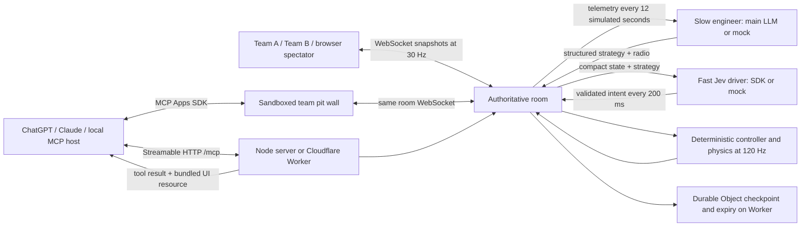

# Jev Grand Prix

Two teams. Two speeds of intelligence. One Monza race. Built for Ruben Casas ([@Infoxicador](https://x.com/Infoxicador)).

**Vector** is calm and precise, in orange. **Chaos** is aggressive, in violet. Each has a slow race engineer and a fast driver. Choose **Jev vs Jev** or **Jev vs Luna**; in the latter, Vector uses Jev and Chaos uses GPT-6 Luna through OpenAI Decisions. The engineer chooses strategy; Jev chooses structured driving intent; a deterministic local controller handles acceleration, braking and line following. Every window watches the same authoritative race.

## Run

Requires **Node.js 22+** (verified on 24.14.0).

```sh
cd jev-grand-prix
npm ci
npm run demo
```

The launcher starts a local server on **http://127.0.0.1:5277** and opens three independent Chromium app windows side by side: **Vector | Broadcast | Chaos**. It installs Chromium if missing. Ctrl+C or closing a demo window cleans up its browsers and server. An occupied port is rejected; use `PORT=5278 npm run demo` for another instance. The demo defaults to `JEV_MOCK=1`, even when a local key exists.

Manual windows:

```sh
npm run dev
# http://127.0.0.1:5277/?team=a
# http://127.0.0.1:5277/?team=b
# http://127.0.0.1:5277/?spectate
```

Production assets locally: `npm run build && npm start`. Reachability: `curl --fail http://127.0.0.1:5277/health`. Circuit tour: `/?track`.

Keep both team seats open. Missing seats pause physics without losing laps, tyres or strategy. WebSockets reconnect with backoff; an occupied seat becomes a spectator. Separate rooms have distinct owner, team and sandbox capabilities. Team credentials live in URL fragments and the WebSocket join message. Spectator URLs contain none.

## Record for X

Maximize the broadcast window to 1440×980 or 1920×1080. **Title sequence → Lights out** resets the default race and gives a clean recording start. The opening title is also available with `/?spectate&intro`. The engineer/radio panels, battle banner, timing tower and telemetry work with the sound muted.

Use **07 Onboard**, **23 Onboard**, **Broadcast** or **Aerial** to switch cameras. Onboard includes the physical halo, visible nose/wheels and a steering wheel dash with gear, speed, DRS and ERS. Broadcast cycles through chase, trackside and helicopter cameras; overtakes and near misses trigger cuts. **Instant replay** replays the closest captured on-track lead change at 0.65×; **Back to live** restores the race. Results show classification, race and best-lap times, tyre stops and the winner. **Race again** resets the owner’s race.

Three laps take about 80–100 wall seconds at the default **4× race clock**. `RACE_SPEED=1` uses real simulation time; up to 24× is supported for tests. Tyre degradation is deliberately accelerated so undercuts matter in three laps. Each pit-wall view has **Push / Manage / Box, box** radio overrides; they take priority for three wall seconds. Engineers otherwise update every 12 simulated seconds (3 wall seconds at 4×). Drivers request a decision every 200 ms, with one request in flight per team. A late response never advances or rewinds physics.

## Real agents and keys

No keys were copied from Pong. All verification uses mocks or injected fixtures. To configure real agents:

```sh
cp .env.local.example .env.local
```

For a direct Jev key:

```dotenv
JEV_PROVIDER=typesafe
TYPESAFE_API_KEY=your-key
JEV_MODEL=jev-latest
JEV_MOCK=0
```

Or choose `JEV_PROVIDER=openrouter` with `OPENROUTER_API_KEY` and `JEV_MODEL=jev-1.13`; or `JEV_PROVIDER=vercel` with `AI_GATEWAY_API_KEY` and `JEV_MODEL=typesafe-ai/jev`. This reuses Pong’s official `@typesafe-ai/sdk` 0.7.0 `TypeSafeClient.systemOne({state,questions})` integration, with `choice()` questions for line, pace, brake aggression, ERS, DRS and a persona-driven radio reply. [Official SDK source](https://github.com/typesafe-ai/typesafe-sdk-js).

The slow engineer uses server-side OpenRouter or Vercel AI Gateway chat completions:

```dotenv
ENGINEER_PROVIDER=openrouter
OPENROUTER_API_KEY=your-key
ENGINEER_MODEL=openai/gpt-4.1
ENGINEER_MOCK=0
```

For Gateway, set `ENGINEER_PROVIDER=vercel` and `AI_GATEWAY_API_KEY`. The model is configurable. Engineer output is validated JSON: pace, ERS mode, pit instruction, next compound, attack/defend/hold and a short radio line. Failures use explicitly labelled rule-based fallbacks. Requests have timeouts and no automatic retries.

Run `JEV_MOCK=0 npm run demo` to opt into configured live providers. `npm run dev` and `npm start` read `.env.local`; no configured key means automatic mock for that brain. **`JEV_MOCK=1` overrides every provider**, including the engineer. `ENGINEER_MOCK=1` mocks only engineers. Keys, provider URLs and SDK clients stay on the server; no provider secrets are bundled into web or MCP HTML. Live API availability and spending were not tested. The UI labels mock, live and fallback decisions individually. The header shows **APIS CONFIGURED** until a real response is observed, **JEV LIVE** after successful Jev decisions, or **API FALLBACK** when a driver fails. The driver card shows **confirmed responses / attempts** and a safe error message with HTTP status. `/health` exposes the same per-team attempt/success/fallback counters and latest error metadata. A configured key alone does not establish successful inference.

Authentication failures (401/403) disable further Jev requests until the server restarts. Correct the ignored `.env.local` key, stop the old process and run `JEV_MOCK=0 npm run demo`. Rate limits honor `Retry-After`; transient network/provider failures use bounded backoff. Cooldowns survive seat reconnects and race resets. Raw provider response bodies and keys never enter public error messages.

## Jev versus Luna

```sh
npm run demo:luna
```

This opens **Vector / Jev** against **Chaos / GPT-6 Luna**. It defaults to mock mode. The race owner can also choose **Jev vs Luna** from the **Drivers** selector above the feed; changing the matchup starts a fresh race and updates every connected view. Team seats and invitation credentials stay intact. `RACE_MATCHUP=jev-vs-luna` selects the initial mode for `npm run dev` or `npm start`.

For real Jev and real Luna, put both keys in the ignored `.env.local`:

```dotenv
JEV_PROVIDER=typesafe
TYPESAFE_API_KEY=your-typesafe-key
JEV_MODEL=jev-latest
OPENAI_API_KEY=your-openai-key
ENGINEER_MOCK=1
```

Then launch explicitly:

```sh
JEV_MOCK=0 LUNA_MOCK=0 npm run demo:luna
```

Stop an existing demo first so port 5277 is free. Engineers remain mocked in this example; configure them separately above if desired. Real Jev success displays **JEV / SYSTEM ONE**; real Luna success displays **LUNA / DECISIONS**. Both driver panels expose confirmed-response counters. **LIVE + MOCK** indicates one driver lacks a key or is explicitly mocked; **API FALLBACK** means an attempted provider call failed.

Luna ports Pong’s server-side **`POST https://api.openai.com/v1/decisions`**, pinned to **`gpt-6-luna`**. It receives compact JSON telemetry and the engineer instruction, then answers the same six bounded choices as Jev: racing line, pace bias, brake aggression, ERS, DRS and a persona radio reply. Named answers are decoded independently of order; refusals, missing/duplicate answers, invalid choices/confidence, wrong models, HTTP failures and timeouts are labelled Luna fallbacks. No automatic HTTP retries occur. See the [official OpenAI Decisions guide](https://developers.openai.com/api/docs/guides/decisions).

As in Pong, live Luna defaults to **600 ms after each response**, paced further by actual input tokens, the tighter configured/provider token budget and request limits, with 20% headroom. Configure `LUNA_INTERVAL_MS` (200–60000, default 600) and `LUNA_TPM_BUDGET` (default 60000). The local controller continues at 120 Hz while inference is in flight. HTTP 429 honors `Retry-After`, including long daily limits. The panel reports recognized numeric quota units without exposing upstream messages, organization IDs or keys. Authentication failures require a corrected key and server restart. Provider cooldowns survive race reset, seat reconnect and switching away from and back to Luna.

`JEV_MOCK=1` forces **all** providers to mocks; `LUNA_MOCK=1` mocks only Luna. No key automatically mocks that driver; `LUNA_MOCK=0` explicitly requires `OPENAI_API_KEY`. All tests, including the full Jev-vs-Luna race and MCP invitations, use mock brains or injected response fixtures. No real Luna quota or inference success is claimed by these checks.

## MCP Apps: two hosts, one race

The local server exposes **Streamable HTTP at `/mcp`**. The linked `ui://jev-grand-prix/pit-wall.html` resource bundles the same Three.js renderer and UI in one HTML document using the official MCP Apps SDK. The included host uses `AppBridge` through a separate-origin double-iframe sandbox.

```sh
npm run demo:mcp
# Game + MCP: http://127.0.0.1:5277
# MCP host:   http://127.0.0.1:5278/?player=a&autoplay=1
# Sandbox:    http://127.0.0.1:5279
```

Use another PORT if a demo is already running. Or run `npm run build && npm start`, then `npm run mcp:host` separately. The local host can connect only to a server reachable from its machine; registration in real ChatGPT/Claude accounts was not automated.

1. First host calls `open_grand_prix({player:"a",autoplay:true})`. Without an invitation this creates a new isolated mock race.
2. Copy the **team B invitation** from the app. Clipboard restrictions fall back to a focused, selected, read-only field; press ⌘C / Ctrl+C if needed.
3. Second host calls `open_grand_prix({invite:"jev:…:b:…",autoplay:true})`. It joins the exact room and gets only its own seat, with no owner or opponent credential.
4. **Open web app** opens a credential-free spectator link. Both embedded apps and the browser see the same room, telemetry and radio.

Invitations also work in the browser: **Invite a team → Join by invitation**, or open the invited team URL. `player:"both"` runs both empty seats from one app; copying an invitation releases team B. `player:"spectator"` starts none. Closing/stopping an app releases only its own controllers. Visibility changes stop owned controllers and hide its WebGL canvas; the race pauses if either team is missing. Host theme variables, safe areas, fullscreen, openLink and teardown are handled. `grand_prix_status({room})` reads state without starting AI calls.

Local MCP rooms expire after two hours. Public Worker rooms expire after 15 minutes and always force mocks. Pass `matchup:"jev-vs-luna"` when creating a race to select Luna. An invitation preserves the existing room’s matchup regardless of the second host’s defaults. The included host accepts `?player=a&autoplay=1&matchup=jev-vs-luna`. MCP protocol, sandbox, invitations and shared-race behavior are tested with the actual SDK, not a simulated postMessage host.



## Circuit and simulation

The centreline is **real Monza geometry**, from [`bacinger/f1-circuits`, `circuits/it-1922.geojson`](https://github.com/bacinger/f1-circuits/blob/master/circuits/it-1922.geojson). The original file is checked into `data/monza.geojson`; `monza.json` is the identical JSON import used by Node, Vite and workerd. Copyright © 2019–2025 Tomislav Bacinger, **MIT licence**, included in [data/LICENSE-f1-circuits.txt](data/LICENSE-f1-circuits.txt).

Coordinates are projected to local metres at the circuit latitude. The measured closed centreline is **5,793.163 m**, within 0.003% of [Monza’s published 5,793 m](https://www.monzanet.it/tracciato-pista-monza/). It is never scaled to force the result. The GeoJSON’s first vertex is partway up the straight; a 310 m station shift aligns the presentation’s control line approximately with the FIA map. Named corners include Rettifilo, Curva Grande, Roggia, both Lesmos, Ascari and Parabolica.

Sector and DRS placement follows the [2025 FIA circuit map](https://www.fia.com/system/files/decision-document/2025_monza_event_-_circuit_map_-_monza_2025.pdf): S1 233 m before T4, S2 215 m before T8, first DRS detection 95 m before T7 and activation 170 m after it, second detection after T11 and activation 12 m after the control line. Corner stations, pit-lane offset and infrastructure are hand-annotated approximations on the sourced centreline, not a surveyed digital twin. The 2025 DRS format is intentional; this demo is not a simulation of 2026 sporting regulations. The FIA map is referenced, not redistributed or relicensed as MIT.

The deterministic model includes throttle/braking, eight gears, curvature-aware speed limits and braking lookahead, smoothed lateral intent, grip, slipstream, dirty air, detection-latched ≤1s DRS eligibility, zone-limited activation, deploy/balanced/harvest ERS, soft/medium/hard compounds, temperature and wear, fuel mass/consumption, an 80 km/h pit limiter, a **2.6 s** stationary tyre change, track-limit warnings and five-second penalties, sectors, best/last laps and finishing classification. The speed trap is sampled at its track station. Replay stores the best on-track lead change. Mock engineers deliberately use different stop windows; a controlled test proves the early undercut changes the outcome.

The scene uses procedural low-poly cars, track ribbons, Italian kerbs, run-off/gravel, barriers, grandstands, garages, start gantry, parkland, lighting, contact shadows and distance fog. Scenery batches by material; trees are instanced and kept clear of the racing surface. No external images/fonts are fetched at runtime. Renderer pixel ratio is capped at 1.5.

## What is mocked or simplified

Default Jev/Luna decisions and engineer dialogue are deterministic rule-based mocks, labelled on screen. Fixture tests exercise the actual Jev SDK and engineer JSON adapter without contacting providers. The authoritative server, WebSockets, room capabilities, MCP SDK/Apps bridge, physics, timing, pit stops, browser rendering and shared state are real.

This is a recording demo, not a tyre or aerodynamic engineering simulator. Tyre wear and the race clock are accelerated; lateral motion follows a controller rather than a full rigid-body car model. Track width, scenery and pit-lane geometry are illustrative. No elevation, wet weather, safety car, audio/TTS, realistic damage or official F1 assets are included. Results can change with driver request timing, while fixed physics steps with identical inputs reproduce exactly. Headless screenshot runs can render slowly; the headed hardware GPU test is the performance measurement.

## Verify

```sh
JEV_MOCK=1 npm run verify
npm run test:worker        # local workerd only; no deployment
npm run worker:check       # wrangler dry-run only; no upload
npm run test:performance   # headed Chromium; writes artifacts/performance.json
PORT=5477 npm run demo:smoke
```

`verify` runs strict Node/Worker typechecks, web/MCP/host production builds, Vitest, both full three-context Playwright matchups and the two-context MCP invitation test with a browser spectator. Tests set mock flags regardless of keys. Screenshots are versioned under `artifacts/`: cockpit, broadcast, results, title and MCP view. Full command results and measured limits are in [VERIFICATION.md](VERIFICATION.md).

The original Pong working tree (including its invitation fixes) was copied without `.env.local`, `.git`, dependencies or generated artifacts. Its build and both browser scenarios passed before conversion. Local commit `ebb7eba` preserves that baseline, then M1–M5 evolve it. The source Pong folder was left untouched.

Cloudflare configuration targets a new **`jev-grand-prix`** Worker with Durable Objects, static assets, room rate limits, mock-only public agents, checkpoints and expiry alarms. `npm run dev:worker` runs locally. No account id, provider secrets or previous Pong deployment URL is inherited. **Nothing was deployed, published or pushed.**
